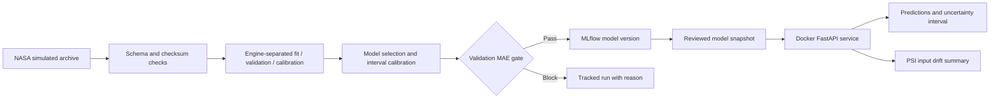

# Engine Prognostics Lab

**Remaining useful life estimation on all four NASA C-MAPSS simulated turbofan fleets.** The core combines operating-regime normalization, causal degradation features, engine-separated model selection, calibrated intervals and official held-out evaluation. It is a working modelling pipeline, not an interface around hand-entered predictions.

Open the **[offline report](reports/latest/index.html)** after downloading the repository. GitHub displays HTML source; double-click the downloaded file to use the controls. Inspect [metrics](reports/latest/results.json), [terminal predictions](reports/latest/predictions.csv) or [model cards](models/model_cards.json) directly online. Fitted models are included in `models/`; raw datasets are retrieved separately.

## What it does

1. **Validate original trajectories:** 26 finite numeric columns, positive integral IDs/cycles, no duplicate records, contiguous per-engine cycles and exact alignment of official terminal RUL labels.
2. **Separate engines:** deterministic fitting/validation/calibration partitions within each training fleet. Roughly 60%/20%/20% of engines, never a random split of rows from the same engine. Official train and test numeric IDs occupy different namespaces and are not the same physical units.
3. **Normalize operating conditions:** fit one regime for FD001/FD003 and six settings-based clusters for FD002/FD004 using fitting engines only. Normalize sensors within regimes; retain a floor on scale estimates and remove globally constant sensors.
4. **Engineer causal features:** current normalized readings plus trailing means, standard deviations and slopes over at most 20 cycles, resetting at every engine boundary. Include observed age and operating settings. No future reading or failure-cycle label enters an inference feature.
5. **Compare candidates:** an age/lifetime baseline, standardized Ridge regression and histogram gradient boosting. Give fitting rows equal total weight per engine. Use one reproducible pre-failure endpoint per validation engine to choose the candidate by MAE. Disable internal random-row early stopping.
6. **Calibrate uncertainty:** one distinct endpoint per calibration engine, absolute residuals and the finite-sample split-conformal quantile. Lower bounds are nonnegative; upper bounds can exceed the point-estimate cap. Do not refit on calibration engines.
7. **Evaluate official test engines:** predict only at the final supplied cycle, compare with the publisher's RUL vector, export per-engine predictions and recompute MAE, RMSE, asymmetric overestimation penalty, interval coverage and review-screen diagnostics.
8. **Persist and infer:** save compressed fitted models, reload them and reproduce predictions. A separate inference command accepts observed prefixes and needs no RUL label file.

## Run

Python **3.12+**. Tools: **NumPy, pandas, scikit-learn, joblib, MLflow, FastAPI and Uvicorn**; native SVG/JavaScript for the offline report. No GPU, paid API, cloud service, R or Stata is needed. CPU thread use is limited to two for model operations.

```powershell
python -m venv .venv
.venv\Scripts\python.exe -m pip install -e ".[dev]"
.venv\Scripts\python.exe run.py download
.venv\Scripts\python.exe run.py train
```

The downloader verifies the pinned SHA256 of `CMAPSSData.zip` and preserves mismatched existing files. Training reads archive members directly with CRC verification; extraction is unnecessary. Internet is needed for dependency installation and the first download, not for analysis/report browsing.

```powershell
# Train just one benchmark fleet into separate output locations.
.venv\Scripts\python.exe run.py train --subsets FD001 --models models/custom --output reports/custom

# Inference from the text trajectory file you want to evaluate:
.venv\Scripts\python.exe run.py predict --model models/FD001.joblib --input path\to\observed_prefixes.txt --output reports/inference.csv
```

On Linux/macOS use `.venv/bin/python`. An installed wheel provides `engine-lab`. Observed prefixes must contain the same 26 source-format columns, one or more engines, and complete cycles from one onward; use the model for the matching subset. Inference does not read an official target file. Joblib uses Python serialization: load models you trust. Library versions are pinned because serialized estimators depend on them.

## Verified benchmark results

| Subset | Training engines | Official test engines | Selected candidate | Test RMSE, cycles | Empirical interval coverage |
|---|---:|---:|---|---:|---:|
| FD001 | 100 | 100 | Gradient boosting | 18.65 | 80.0% |
| FD002 | 260 | 259 | Gradient boosting | 28.53 | 78.4% |
| FD003 | 100 | 100 | Gradient boosting | 17.89 | 99.0% |
| FD004 | 249 | 248 | Ridge | 33.53 | 84.7% |

Totals: **160,359 training rows, 104,897 test rows, 709 training engines and 707 official test engines**. The FD004 engine counts above come from the actual files; the publisher README/catalogue prose reverses the train/test counts. Original files are preserved rather than edited to match that prose.

These results use one declared split and fixed candidate hyperparameters. Validation selects the candidate; official test comparisons are diagnostic and do not choose it. Ridge is retained on FD004 because it performs better on the separate validation endpoints, even though a more complex model is available. All test score denominators are engines, not correlated cycle rows.

## Interpretation and boundaries

Training uses piecewise RUL targets capped at **125 cycles**. Point estimates are clipped to that range. Official evaluation uses **uncapped true RUL**, so long remaining lifetimes can be underestimated; clipped-target results are saved separately and never substituted silently for the official target. Calibration uses uncapped endpoint errors and can therefore produce wide intervals.

Validation/calibration endpoints are chosen once per engine at a deterministic 35%–85% fraction of its run-to-failure trajectory. Ground-truth failure cycles generate labels, not features. This approximates truncated observation but does not reproduce an established censoring mechanism. The nominal **80%** split-conformal coverage relies on exchangeability of endpoint examples; different official truncation and operating distributions can change coverage. FD002's observed coverage is below 80%, while FD003's wide interval overcovers. The report shows both empirical coverage and width rather than promising per-engine guarantees.

The review slider flags an engine when the lower interval bound crosses an assumed horizon. This illustrates the tradeoff between missed near-failure cases and review workload. It is not an optimized maintenance policy, certified safety limit, actual intervention or estimate of money saved. Actual fleets, sensor faults, censored field outcomes, changing operating conditions and operational economics need separate validation before deployment.

The first three test units provide reproducible trajectory illustrations selected by ID, not by performance. Actual trajectory lines are reconstructed retrospectively for comparison; predictions at each displayed cycle use only prior/current observations and the previously fitted model.

## MLOps lifecycle

This repository also demonstrates a compact, end-to-end lifecycle around the prognostic model:



- **Experiment tracking:** each fleet run logs its seed, model choice, feature count, dataset hash, validation metrics and separate official-test diagnostics to MLflow. The default backend is local SQLite (`mlflow.db`), which is ignored by Git.
- **Promotion gate:** a model can be registered only when its engine-separated validation MAE beats the age-only baseline. The official test set never decides promotion. A blocked candidate is still recorded with its reason.
- **Model lineage:** MLflow stores the serialized predictor and, for a passing candidate, registers a versioned model with the experiment that produced it.
- **Input contract and inference:** FastAPI validates the 26 source columns, integer engine/cycle identifiers, finite values and contiguous observed cycles before returning RUL intervals.
- **Drift monitoring:** inference compares engineered input-feature distributions with the fitting-engine reference profile using PSI (Population Stability Index). The 0.20 alert line is a heuristic for investigation, not a universal threshold or proof of model failure.
- **Packaging and CI:** Docker Compose provides a local prediction API and MLflow UI; GitHub Actions runs the existing focused test suite and builds the deployment image.

### Local run

Install the package as shown above, then train the four models. The training command creates/upgrades the SQLite tracking store and registers only candidates that pass the validation gate:

```powershell
.venv\Scripts\python.exe run.py train --tracking-uri sqlite:///mlflow.db
.venv\Scripts\python.exe -m mlflow server --backend-store-uri sqlite:///mlflow.db --host 127.0.0.1 --port 5000 --workers 1
```

Open `http://127.0.0.1:5000` for experiments and registered model versions. In another terminal, start one fleet-specific API:

```powershell
.venv\Scripts\python.exe run.py serve --model models/FD001.joblib --host 127.0.0.1 --port 8000
```

The interactive API contract is at `http://127.0.0.1:8000/docs`; `GET /health` shows the loaded fleet and `GET /schema` gives the exact input columns. `POST /predict` accepts observed trajectory rows as JSON records. Each request must contain complete cycles beginning at cycle 1; it returns one estimate per engine plus an input-drift summary. It never accepts or requires an RUL target.

### Docker run

With Docker Desktop running:

```powershell
docker compose up --build
```

The API is at `http://127.0.0.1:8000/docs` (FD001 snapshot); the MLflow UI is at `http://127.0.0.1:5000`. Both ports bind to localhost only. The container image excludes raw source data, reports, tests and local experiment databases. It contains the published FD001 model snapshot; to deploy a newly trained model, rebuild the image from the reviewed artifact.

To send a training run to the Compose MLflow server instead of the local SQLite file, run this from the project directory after Compose is up:

```powershell
.venv\Scripts\python.exe run.py train --tracking-uri http://127.0.0.1:5000
```

### Operational scope

This is a reproducible local demonstration, not a production airline service. C-MAPSS is simulated; PSI detects changes in input distributions but cannot establish a change in predictive accuracy without later observed outcomes. The promotion rule is a transparent portfolio-project gate, not an aviation safety standard. No automatic retraining or maintenance action is triggered. A real deployment would require licensed operational data, delayed-outcome monitoring, security review, service authentication, a managed artifact store and domain approval.

## Verification

```powershell
.venv\Scripts\python.exe -m pytest -q
.venv\Scripts\python.exe scripts/verify_artifacts.py
.venv\Scripts\python.exe scripts/check_browser.py
```

Tests cover invalid trajectories/targets, engine boundaries, future-observation mutation, trailing-window calculations, finite-sample calibration ranks, hand-calculated asymmetric metrics, undefined precision/recall, automatic baseline selection, model reload and label-free inference. The independent verifier reads original archive arrays, reconstructs splits, recomputes terminal metrics/coverage, checks model hashes and confirms the saved normalization statistics came from fitting engines only. Browser checks exercise four fleets, trajectory controls, review thresholds, all CSV downloads and desktop/mobile layout. The optional browser script uses installed Windows Chrome; adjust its executable path for another machine.

```text
src/engine_lab/      validation, features, models, calibration, CLI and report
models/             fitted joblib artifacts and model cards
tests/              synthetic edge cases and full pipeline tests
scripts/            independent source audit and real browser checks
data/manifest.json  original acquisition record and implementation pointer
reports/latest/     offline report, metrics, CSV predictions and audit evidence
.private/           ignored logs, screenshots, packaging and installation checks
```

## Attribution and data provenance

Source: [NASA C-MAPSS Jet Engine Simulated Data](https://data.nasa.gov/dataset/cmapss-jet-engine-simulated-data). Original reference: A. Saxena, K. Goebel, D. Simon and N. Eklund, *Damage Propagation Modeling for Aircraft Engine Run-to-Failure Simulation*, PHM 2008. The asymmetric metric uses a stronger penalty for overestimating life, following the benchmark convention discussed in [NASA's prognostics dataset paper](https://ntrs.nasa.gov/api/citations/20205001125/downloads/Run_to_Failure_Simulation_Under_Real_Flight_Conditions_Dataset.pdf).

The [source manifest](data/manifest.json) preserves retrieval URLs, dates and locally computed hashes; these are not publisher checksums. The NASA catalogue does not specify a dataset licence. Raw archive, publisher material and extracted source files remain ignored in `data/raw/`; retain attribution and inspect applicable terms before redistributing them. Published predictions and model weights are derived benchmark results. Engine IDs refer only to simulated units; no private colleague, airline, aircraft-tail or passenger identifiers are introduced. No actual airline deployment, proprietary dataset or operational savings are claimed.
